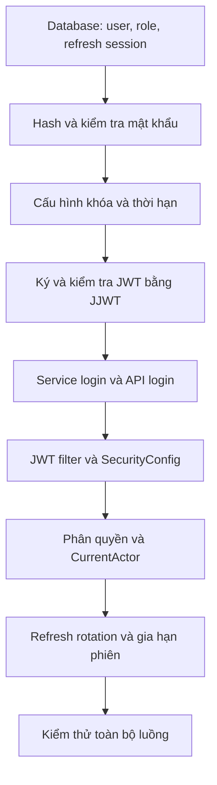

# Hướng dẫn làm authentication backend từng bước

## 1. Bắt đầu từ đâu?

Bắt đầu từ **database tài khoản và cơ chế kiểm tra mật khẩu**, sau đó mới làm phần cấp JWT và bảo vệ API. Mục tiêu đầu tiên là chứng minh backend đọc được user và so khớp được mật khẩu đã hash.

Tài liệu này hướng dẫn thứ tự triển khai theo code trong `pda-management`. Dự án đã có các thành phần bên dưới; khi học hoặc chỉnh sửa, hãy mở file tương ứng thay vì tạo thêm một hệ thống auth song song. Chi tiết hành vi hiện tại nằm trong [Authentication trên Management backend](29-management-authentication.md).

Phần xác thực sử dụng:

- Java 8, Spring Boot 2.7.0.
- `spring-boot-starter-security` để quản lý filter, security context, BCrypt và phân quyền.
- JJWT **0.11.5** để ký và kiểm tra JWT.
- MyBatis để truy cập user, roles và phiên trong database.

Không dùng Spring OAuth2 Resource Server. Những dependency phục vụ database hoặc nghiệp vụ khác vẫn giữ vai trò riêng.

Thứ tự triển khai:



Các đường dẫn Java trong tài liệu tính từ `pda-management/src/main/java/com/company/pda/`.

## 2. Bước 1 — Chuẩn bị database và repository

Các bảng phục vụ auth:

| Bảng | Dữ liệu cần có |
| --- | --- |
| `stores` | Cửa hàng của user |
| `users` | Username duy nhất, mật khẩu đã hash, cửa hàng, trạng thái active |
| `roles` | Tên quyền, ví dụ `MANAGER`, `EMPLOYEE` |
| `user_roles` | Liên kết user với roles |
| `refresh_tokens` | ID token, family ID, user ID, hash token, hạn dùng, trạng thái đã dùng/thu hồi |

`family_id` định danh một phiên đăng nhập. Mỗi lần refresh tạo một bản ghi token mới nhưng vẫn giữ family đó.

Mở lần lượt:

1. `domain/auth/model/User.java` và `Refresh.java`: dữ liệu nghiệp vụ.
2. `domain/auth/repository/AuthRepository.java`: các thao tác service cần.
3. `infrastructure/persistence/mybatis/repository/MyBatisAuthRepository.java`: triển khai repository.
4. `infrastructure/persistence/mybatis/mapper/UserMapper.java` và `src/main/resources/mapper/UserMapper.xml`: truy vấn database.

Trước tiên kiểm tra được `user(username)`, `userById(id)` và `roles(id)`. Sau đó bổ sung các thao tác `saveRefresh`, `refresh`, `consume`, `revoke`, `activeSession` để quản lý phiên.

**Điều kiện chuyển bước:** đọc đúng user, trạng thái active và danh sách role từ database đã chọn.

**Tình trạng database hiện tại:** các script trong `db/migration` và `db/legacy` đã chuyển sang Oracle 19c, nhưng JDBC dependency, datasource, mapper và integration tests vẫn dùng PostgreSQL. Vì vậy cần đồng bộ database trước khi thử login thật. Xem [giới hạn tích hợp database](../pda-management/src/main/resources/db/README.md).

- Nếu chạy PostgreSQL: cần bộ migration PostgreSQL phù hợp, ví dụ từ phiên bản trước; không chạy DDL Oracle lên PostgreSQL.
- Nếu chạy Oracle: cần chuyển cả driver, datasource, mapper, type handler, bootstrap/seed và test sang Oracle. Chỉ đổi JDBC URL chưa đủ.

## 3. Bước 2 — Hash và kiểm tra mật khẩu

Mở:

- `application/port/out/PasswordHasher.java`.
- `infrastructure/security/PasswordEncoderConfig.java`.

Code hiện tại dùng `BCryptPasswordEncoder(12)` và bọc nó qua `PasswordHasher` để service không phụ thuộc trực tiếp vào BCrypt.

Khi tạo tài khoản:

```java
String passwordHash = passwords.encode(rawPassword);
// Lưu passwordHash vào users.password_hash.
```

Khi đăng nhập:

```java
boolean valid = passwords.matches(rawPassword, user.passwordHash());
```

Không gọi `encode(rawPassword)` rồi so sánh hai chuỗi hash: BCrypt tạo salt cho mỗi lần encode nên kết quả có thể khác nhau. Database chỉ lưu hash, không lưu mật khẩu gốc.

Để thử lần đầu cần một user active, có cửa hàng và role hợp lệ, với hash tạo bằng đúng password encoder. `/auth/register` hiện yêu cầu role `MANAGER`, nên không thể dùng endpoint này để tự tạo manager đầu tiên khi chưa có tài khoản.

`BootstrapAdmin` có thể tạo admin khi bật bootstrap và database chưa có user, nhưng SQL của lớp này hiện dành cho PostgreSQL; cần xử lý theo lựa chọn database ở bước 1.

**Điều kiện chuyển bước:** mật khẩu đúng trả `true`, mật khẩu sai trả `false`; user thử nghiệm có hash hợp lệ.

## 4. Bước 3 — Khai báo dependency và cấu hình

Trong `pda-management/pom.xml`, các dependency xác thực là:

```xml
<dependency>
  <groupId>org.springframework.boot</groupId>
  <artifactId>spring-boot-starter-security</artifactId>
</dependency>
<dependency>
  <groupId>io.jsonwebtoken</groupId>
  <artifactId>jjwt-api</artifactId>
  <version>0.11.5</version>
</dependency>
<dependency>
  <groupId>io.jsonwebtoken</groupId>
  <artifactId>jjwt-impl</artifactId>
  <version>0.11.5</version>
  <scope>runtime</scope>
</dependency>
<dependency>
  <groupId>io.jsonwebtoken</groupId>
  <artifactId>jjwt-jackson</artifactId>
  <version>0.11.5</version>
  <scope>runtime</scope>
</dependency>
```

Các property cần hiểu:

| Property | Ý nghĩa | Giá trị hiện tại / yêu cầu |
| --- | --- | --- |
| `app.jwt-secret` | Khóa ký và kiểm tra HS256 | Base64 của ít nhất 32 byte ngẫu nhiên |
| `app.issuer` | Định danh bên cấp token | `retail-pda` |
| `app.auth.access-seconds` | Thời gian access token | 900 giây |
| `app.auth.session-seconds` | Thời gian phiên / refresh token | 7200 giây |
| `app.auth.warning-seconds` | Thời gian cảnh báo trước hạn phiên | 300 giây |

`SecurityConfig.jwtKey()` giải mã khóa Base64 và kiểm tra độ dài. `SessionPolicy` kiểm tra thời hạn: access dương, session dài hơn access, warning dương và ngắn hơn session.

Khi triển khai, cấp khóa riêng qua biến môi trường `APP_JWT_SECRET` thay cho khóa mẫu trong `application.yml`. Giữ khóa ổn định giữa các lần khởi động và dùng cùng khóa cho các instance của cùng backend; đổi khóa sẽ làm token cũ không còn xác thực được. Không đưa khóa vào tài liệu, log hoặc response API.

**Điều kiện chuyển bước:** tạo được bean khóa và `SessionPolicy`; cấu hình khóa/thời hạn sai phải làm khởi tạo thất bại.

## 5. Bước 4 — Làm JwtTokenProvider

Mở `application/port/out/TokenProvider.java` và `infrastructure/security/JwtTokenProvider.java`.

Provider cần có bốn thao tác:

| Thao tác | Kết quả |
| --- | --- |
| `access(...)` | Tạo access JWT cho user, roles, cửa hàng và family |
| `refresh(...)` | Tạo refresh JWT có ID bản ghi refresh |
| `verifyAccess(token)` | Kiểm tra access JWT và trả JJWT `Claims` |
| `verifyRefresh(token)` | Kiểm tra refresh JWT và trả UUID từ `jti` |

Access token mang `iss`, `sub`, `aud=retail-api`, `iat`, `exp`, `type=access`, `sessionId`, `storeId`, `roles`. Refresh token mang `iss`, `sub`, `aud=retail-refresh`, `iat`, `exp`, `type=refresh`, `jti`.

JJWT ký bằng HS256. Khi nhận token, phải kiểm tra chữ ký, issuer, thuật toán, hạn dùng, loại token và audience; không chỉ giải mã payload để tin dữ liệu bên trong. JWT được ký không có nghĩa nội dung được mã hóa, nên không đặt mật khẩu hoặc secret trong claims.

`verifyAccess()` là phương thức phục vụ filter ở infrastructure; interface `TokenProvider` cho application chỉ cần các thao tác cấp token và xác minh refresh hiện có.

**Điều kiện chuyển bước:** token tự cấp được chấp nhận; token sai chữ ký, sai issuer, hết hạn, thiếu `exp` hoặc sai loại bị từ chối. Refresh token không được dùng thay access token.

## 6. Bước 5 — Làm service và API login

Mở theo thứ tự:

1. `application/auth/dto/LoginCommand.java` và `TokenResult.java`.
2. `application/auth/usecase/AuthUseCase.java`.
3. `application/auth/service/AuthenticationService.java`.
4. `presentation/rest/auth/dto/LoginRequest.java` và `LoginResponse.java`.
5. `presentation/rest/auth/AuthController.java`.

Luồng `login()` trong service:

1. Tìm user theo username.
2. Kiểm tra mật khẩu bằng `PasswordHasher.matches()`. Không tìm thấy user thì vẫn kiểm tra với dummy hash.
3. Từ chối nếu sai mật khẩu, không có user hoặc user inactive.
4. Ghi audit `LOGIN`.
5. Tạo family UUID và hạn phiên `now + sessionSeconds`.
6. Tạo access token và refresh token; lưu **hash refresh token** vào database.
7. Trả cặp token và thời hạn cho client.

Login chạy trong transaction. Hạn access token là `min(now + accessSeconds, sessionExpiresAt)`.

Controller chỉ nhận request, validate, chuyển sang command, gọi use case rồi chuyển result sang response. Logic kiểm tra tài khoản và cấp token nằm ở service/provider.

Request tối thiểu:

```http
POST /auth/login
Content-Type: application/json

{"username":"user","password":"password"}
```

Response cho client không gửi header Android gồm:

```json
{
  "accessToken": "<access-jwt>",
  "refreshToken": "<refresh-jwt>",
  "expiresIn": 900
}
```

`expiresIn` là ví dụ cho phiên mới với cấu hình mặc định. Nếu gửi thêm `PDA_TYPE: ANDROID`, response có `serverTime`, `accessExpiresAt`, `sessionExpiresAt` và `warningSeconds`.

**Điều kiện chuyển bước:** login đúng trả token và tạo bản ghi refresh; login sai hoặc inactive trả 401; request thiếu trường bắt buộc trả 400.

## 7. Bước 6 — Bảo vệ API bằng filter và SecurityConfig

Mở:

- `infrastructure/security/JwtAuthenticationFilter.java`.
- `infrastructure/security/SessionValidator.java`.
- `infrastructure/security/SecurityConfig.java`.
- `infrastructure/security/JsonAuthenticationEntryPoint.java` và `JwtAuthenticationException.java`.

Filter xử lý mỗi request có `Authorization: Bearer <accessToken>`:

1. Đọc và kiểm tra định dạng Bearer header.
2. Gọi `JwtTokenProvider.verifyAccess()`.
3. Gọi `SessionValidator` để kiểm tra phiên trong database theo `sessionId` và user ID.
4. Đổi roles thành authorities: `MANAGER` thành `ROLE_MANAGER`.
5. Tạo `UsernamePasswordAuthenticationToken` với principal là JJWT `Claims`, credentials là `null` và authorities vừa tạo.
6. Đặt authentication vào `SecurityContext`, rồi cho request đi tiếp.
7. Nếu xác thực thất bại, xóa context và trả 401 qua entry point.

Trong `SecurityConfig`:

- Dùng `SessionCreationPolicy.STATELESS`.
- Đăng ký JWT filter trước `UsernamePasswordAuthenticationFilter`, chỉ một lần trong security chain.
- Cho phép `/auth/login` và `/auth/refresh` không cần access token.
- Các API còn lại mặc định cần xác thực, ngoại trừ danh sách endpoint public/device hiện được cấu hình riêng.
- Cấu hình entry point cho lỗi 401 và handler cho lỗi 403.

`STATELESS` nghĩa là không lưu đăng nhập trong HTTP session. Backend vẫn truy vấn trạng thái phiên ở database để hỗ trợ thu hồi token.

Code hiện tắt CSRF cho API dùng Bearer header. Nếu sau này đổi sang xác thực bằng cookie trình duyệt, cần đánh giá lại CSRF.

`permitAll()` không bỏ qua việc kiểm tra Bearer token sai. Khi gọi login/refresh, client nên gửi request không kèm access token cũ đã hết hạn.

**Điều kiện chuyển bước:** API bảo vệ trả 401 nếu thiếu/sai token; token hợp lệ đi tới controller; phiên bị thu hồi trả `SESSION_REVOKED`.

## 8. Bước 7 — Phân quyền và lấy user hiện tại

Xác thực trả lời “ai đang gọi API”; phân quyền quyết định người đó có được thực hiện thao tác hay không.

`SecurityConfig` đã bật `@EnableMethodSecurity`. Ví dụ hiện có trên `/auth/register`:

```java
@PreAuthorize("hasRole('MANAGER')")
```

Database và claim lưu role là `MANAGER`; filter thêm tiền tố `ROLE_`. Vì vậy dùng `hasRole('MANAGER')`, hoặc `hasAuthority('ROLE_MANAGER')`.

Mở `application/port/out/CurrentActor.java` và `infrastructure/security/SecurityCurrentActor.java`. Service nghiệp vụ lấy user ID/cửa hàng từ `CurrentActor`, không tin user ID/cửa hàng do client tự gửi để quyết định quyền. `SecurityCurrentActor` đọc claims rồi kiểm tra lại user active và cửa hàng khớp database.

**Điều kiện chuyển bước:** manager gọi được API dành cho manager; employee nhận 403; dữ liệu nghiệp vụ được giới hạn đúng cửa hàng.

## 9. Bước 8 — Làm refresh rotation và gia hạn

Mở `AuthenticationService.refresh()`, `RefreshTokenCommand`, `RefreshTokenRequest` và phần mapper refresh.

Luồng refresh:

1. Kiểm tra refresh JWT, lấy `jti`.
2. Đọc bản ghi refresh bằng khóa `SELECT ... FOR UPDATE` trong transaction.
3. So khớp hash token nhận được với hash đã lưu.
4. Kiểm tra chưa bị thu hồi, chưa dùng, chưa hết hạn và user còn active.
5. Đánh dấu token đã dùng bằng UPDATE có điều kiện; kết quả phải đúng một bản ghi.
6. Cấp cặp access/refresh mới trong cùng family và lưu hash refresh mới.
7. Nếu phát hiện token đã dùng bị gửi lại, thu hồi cả family.

Request thông thường:

```http
POST /auth/refresh
Content-Type: application/json

{"refreshToken":"<current-refresh-token>"}
```

Refresh thông thường giữ nguyên giờ hết phiên. Ví dụ login 08:00, hết phiên 10:00; refresh lúc 08:15 vẫn hết phiên 10:00.

Gia hạn chủ động dùng cùng endpoint với body:

```json
{
  "refreshToken": "<current-refresh-token>",
  "extendSession": true
}
```

Khi gia hạn thành công, hạn mới là `now + sessionSeconds`. Token đã hết hạn không thể dùng để gia hạn.

Code dùng `@Transactional(noRollbackFor = DomainException.class)` để thao tác revoke vẫn được commit khi sau đó ném lỗi nghiệp vụ. Khi chỉnh sửa luồng này, kiểm tra cả trường hợp cấp token/lưu database thất bại để tránh commit dữ liệu dở dang.

**Điều kiện chuyển bước:** refresh trả cặp mới; token cũ không dùng lại được; dùng lại token cũ thu hồi family và access token tương ứng; hai request refresh đồng thời không cùng thành công với một token.

## 10. Bước 9 — Kiểm tra mã lỗi

Lỗi filter trả `application/problem+json`, header `WWW-Authenticate: Bearer` và body như:

```json
{
  "status": 401,
  "code": "ACCESS_TOKEN_EXPIRED",
  "detail": "Authentication expired or invalid; sign in again"
}
```

| Trường hợp | HTTP | Code auth hiện có |
| --- | --- | --- |
| Thiếu Authorization trên API bảo vệ | 401 | `AUTH_REQUIRED` |
| Access token không hợp lệ | 401 | `ACCESS_TOKEN_INVALID` |
| Access token hết hạn | 401 | `ACCESS_TOKEN_EXPIRED` |
| Refresh token không hợp lệ | 401 | `REFRESH_TOKEN_INVALID` |
| Phiên / refresh token hết hạn | 401 | `SESSION_EXPIRED` |
| Phiên bị thu hồi | 401 | `SESSION_REVOKED` |
| Đã xác thực nhưng thiếu quyền | 403 | Do access-denied handler hoặc exception handler xử lý, tùy nơi phát sinh |

Lỗi login và refresh từ service đi qua `presentation/exception/GlobalExceptionHandler.java`, không qua entry point của filter. Login sai hiện dùng `InvalidCredentialsException` với thông báo `Invalid credentials`, chưa có code riêng như `INVALID_CREDENTIALS`; không giả định mọi response lỗi đều có một code auth cụ thể.

**Điều kiện chuyển bước:** client phân biệt được token hết hạn, phiên bị thu hồi và thiếu quyền để xử lý đúng.

## 11. Bước 10 — Chạy thử và kiểm thử

Chạy từ thư mục gốc repository:

```powershell
# Kiểm tra riêng JJWT, filter và phân quyền; không cần database thật.
mvn -f pda-management/pom.xml '-Dtest=JwtSecurityTest' test

# Chạy toàn bộ unit tests.
mvn -f pda-management/pom.xml test

# Đóng gói và chạy cả integration tests.
mvn -f pda-management/pom.xml verify
```

`JwtSecurityTest` kiểm tra token hợp lệ, phân quyền, context giữa các request, hết hạn, phiên bị thu hồi, token sai chữ ký/issuer/audience/thuật toán và tách access với refresh. `StoreFlowsIT` kiểm tra thêm các luồng có database như login, refresh, reuse và gia hạn.

Ở lần kiểm tra sau khi chuyển sang JJWT, 20 unit tests đã qua, gồm 6 test trong `JwtSecurityTest`. `verify` chưa qua vì `StoreFlowsIT` dùng PostgreSQL và không khởi tạo được schema Oracle hiện tại. Cần xử lý bước 1 trước khi xác nhận auth hoạt động đầy đủ với database thật.

Sau khi đồng bộ database và tạo user thử nghiệm, khởi động backend với cấu hình datasource tương ứng:

```powershell
mvn -f pda-management/pom.xml spring-boot:run
```

Ví dụ thử bằng PowerShell; thay username/password bằng tài khoản đã tạo:

```powershell
$baseUrl = 'http://localhost:8080'
$loginBody = @{ username = 'user'; password = '<test-password>' } | ConvertTo-Json
$session = Invoke-RestMethod -Method Post -Uri "$baseUrl/auth/login" `
  -ContentType 'application/json' -Body $loginBody

$headers = @{ Authorization = "Bearer $($session.accessToken)" }
# Thay barcode bằng mã sản phẩm thử nghiệm trong đúng cửa hàng.
Invoke-RestMethod -Method Get -Uri "$baseUrl/products/barcode/123" -Headers $headers

$refreshBody = @{ refreshToken = $session.refreshToken } | ConvertTo-Json
$session = Invoke-RestMethod -Method Post -Uri "$baseUrl/auth/refresh" `
  -ContentType 'application/json' -Body $refreshBody

# Sau refresh, cập nhật header với access token mới.
$headers = @{ Authorization = "Bearer $($session.accessToken)" }
```

Danh sách nghiệm thu:

- Login đúng/sai, user inactive và request không hợp lệ.
- API bảo vệ khi thiếu token, token giả, token hết hạn và refresh token giả làm access.
- Manager được phép, employee bị chặn ở API manager.
- `CurrentActor` kiểm tra đúng user và cửa hàng.
- Refresh xoay token, chống dùng lại và xử lý refresh đồng thời.
- Refresh thường giữ hạn phiên; gia hạn chủ động đổi hạn phiên.
- Response login/refresh có và không có `PDA_TYPE: ANDROID`.

Backend hiện chưa có endpoint logout. Nếu bổ sung sau này, triển khai use case thu hồi family để access token có `sessionId` cũng bị từ chối; logout local trên PDA hiện chỉ xóa session phía thiết bị.

## 12. Thứ tự đọc code để thực hành ngay

Nếu mới bắt đầu, hãy hoàn thành lần lượt ba mốc:

| Mốc | File cần tập trung | Kết quả cần đạt |
| --- | --- | --- |
| 1. Đọc user và kiểm tra mật khẩu | `AuthRepository`, `UserMapper.xml`, `PasswordEncoderConfig` | Tìm user và xác minh BCrypt đúng |
| 2. Login và gọi API bằng JWT | `JwtTokenProvider`, `AuthenticationService`, `AuthController`, `JwtAuthenticationFilter`, `SecurityConfig` | Login lấy token; API kiểm tra token và quyền |
| 3. Quản lý vòng đời phiên | `SessionPolicy`, `SessionValidator`, `refresh()`, mapper refresh | Xoay token, thu hồi, hết phiên và gia hạn đúng |

Xem thêm [cơ chế authentication hiện tại](29-management-authentication.md), [chính sách thời hạn phiên](27-jwt-session-policy.md) và [luồng authentication trên PDA](28-pda-authentication.md).
